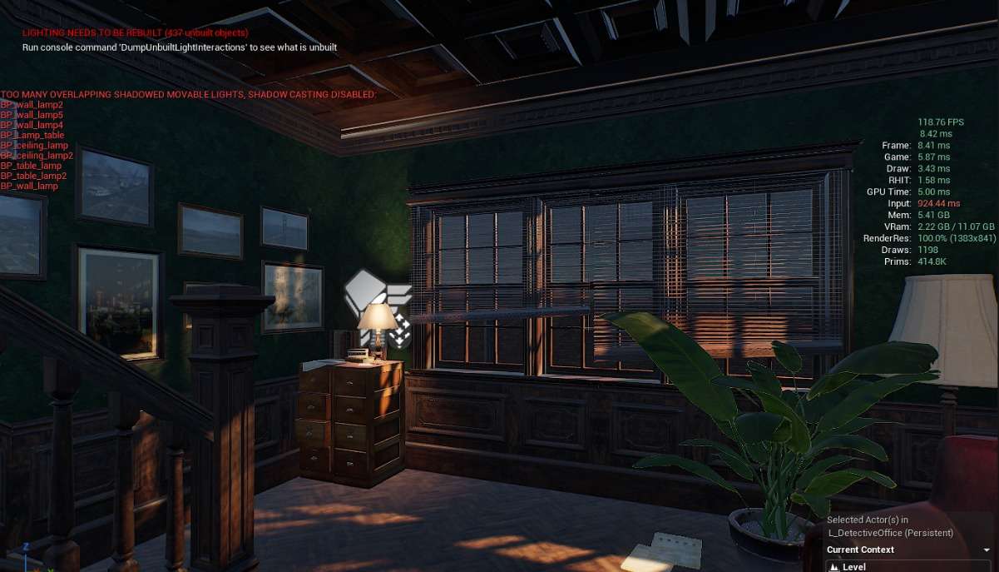
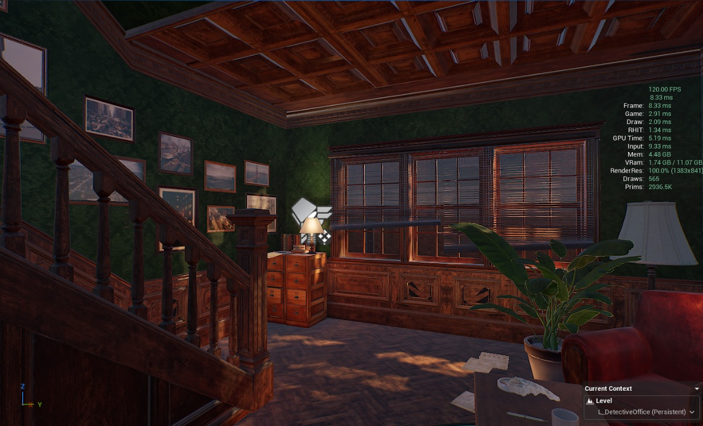
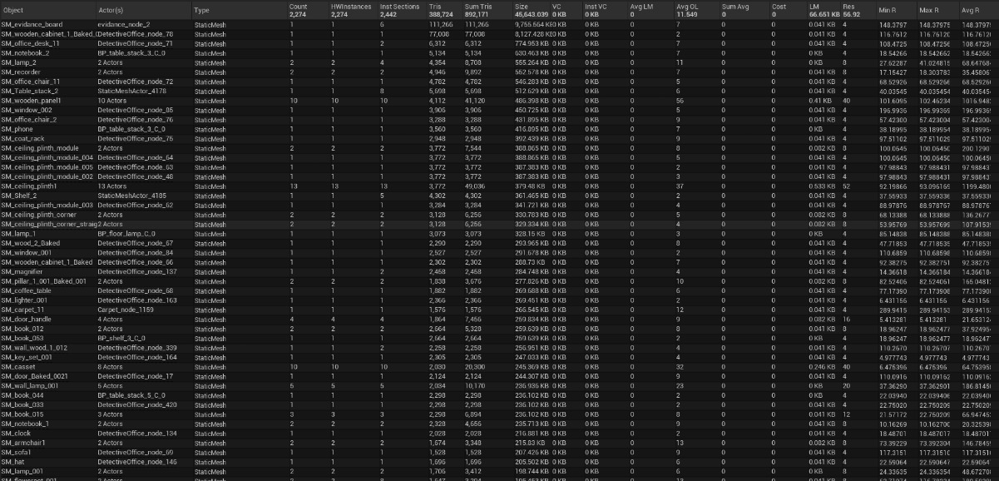
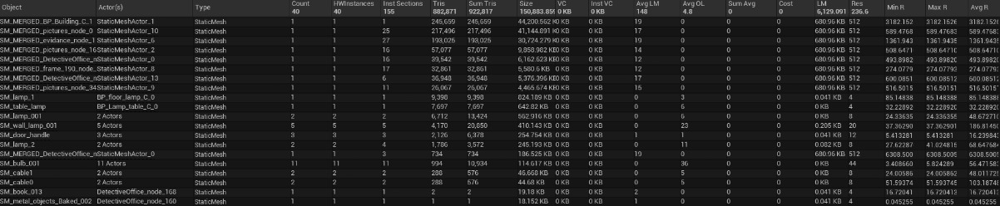
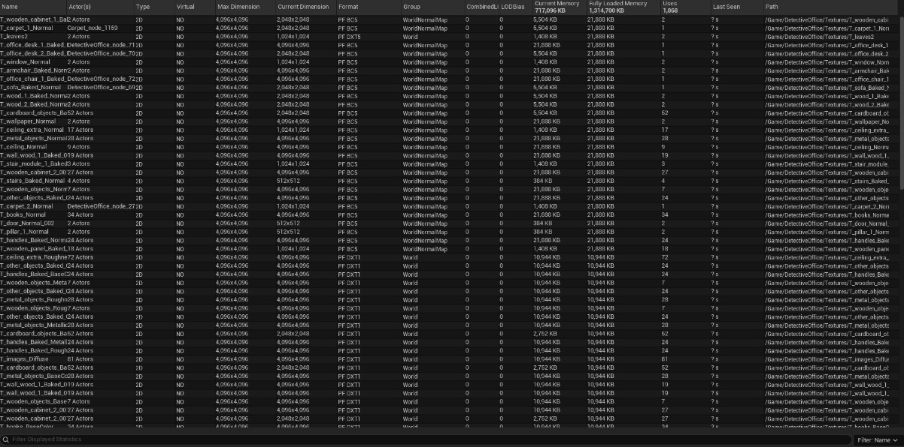
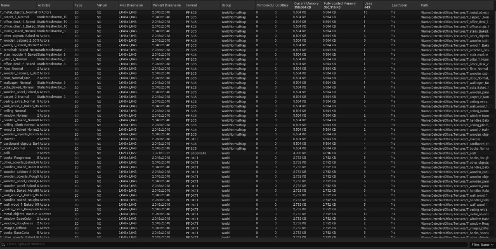

## PROYECTO: Optimización Realidad Virtual
Alumno: Guillermo Mata Vizcaíno

* **Enlace al recurso original (FAB):** [Detective Office - [https://www.fab.com/listings/82fea2b7-ffde-4a9f-9ec7-17faa7504477]
>Para probar y utilizar este proyecto sin necesidad de gafas de Realidad Virtual físicas, es obligatorio ejecutar el archivo `LanzarConSimulador.bat` incluido en la carpeta. La versión original sin optimizar se encuentra en la rama `escena-inicial-sin-optimizar`.

## 1. Comparativa Global de Rendimiento (Antes vs. Después)

| Métrica | Escena Inicial (`escena-inicial`) | Escena Optimizada (`main`) | Mejora / Diferencia |
| :--- | :---: | :---: | :---: |
| **FPS medios** | `118.76 FPS` | `120.00 FPS` *(tope del motor)* | Estable al máximo |
| **Tiempo de Fotograma (`Frame`)** | `8.41 ms` | `8.33 ms` | `-0.08 ms` |
| **Tiempo de CPU (`Game`)** | `5.87 ms` | `2.91 ms` | **`-50.4%` (`-2.96 ms`)** |
| **Tiempo de Render Thread (`Draw`)** | `3.43 ms` | `2.09 ms` | **`-39.1%` (`-1.34 ms`)** |
| **Tiempo de GPU (`GPU Time`)** | `5.00 ms` | `5.19 ms` | `+0.19 ms`  |
| **Draw Calls (`Draws`)** | `1,198` | `565` | **`-52.8%` (`-633 draws`)** |
| **Actores / Mallas en escena (`Count`)** | `2,274` | `40` | **`-98.2%`** |
| **Primitivas en vista (`Prims`)** | `414.8 K` | `2,936.5 K` | Mayor lote por *Merge Actors* |
| **Memoria de Texturas (`Current Memory`)** | `1,697.00 MB` | `384.38 MB` | **`-77.3%` (`-1,312.6 MB`)** |
| **Memoria de Texturas (`Fully Loaded`)** | `2,469.75 MB` | `537.56 MB` | **`-78.2%` (`-1,932.2 MB`)** |
| **RAM / VRAM total en ejecución** | `5.41 GB` / `2.22 GB` | `4.48 GB` / `1.74 GB` | **`-930 MB` RAM / `-480 MB` VRAM** |
| **Errores de iluminación dinámica** | 9 luces solapadas sin sombras | `0 errores` (Bakeada *Production*) | **100% eliminados** |

## 2. Comparativa Visual y de Estadísticas

| Escena Inicial (`escena-inicial`) | Escena Optimizada (`main`) |
| :---: | :---: |
|  |  |

### Auditoría de Geometría

| Antes (`2,274 actores`) | Después (`40 actores` tras Merge Actors) |
| :---: | :---: |
|  |  |

### Auditoría de Texturas

| Antes (`1.69 GB` cargados en 4K) | Después (`384 MB` tras acotar resolución) |
| :---: | :---: |
|  |  |

## 3. Técnicas de Optimización Aplicadas

1. **Reducción de Draw Calls y Gestión de Geometría:**
   * Agrupación de mallas y conjuntos de mobiliario mediante **Merge Actors**, reduciendo el número de mallas en escena en un **98.2%** (De `2,274` a `40`) y recortando las llamadas de dibujado (`Draws`) en un **52.8%** (`1,198` a `565`).
   * Desactivación de **Nanite** y asignación de **LOD Groups** (`LevelArchitecture`, `LargeProp`, `SmallProp`).

2. **Optimización de Texturas y Memoria VRAM:**
   * Auditoría mediante `Tools > Audit > Statistics > Texture Stats` y edición en lote (*Property Matrix*) limitando `Maximum Texture Size` a **2048px**.

3. **Iluminación Estática Bakeada y Configuración VR:**
   * Uso de **Forward Shading** con iluminación global dinámica y reflejos de Lumen deshabilitados.
   * Conversión de todas las luces y Blueprints de iluminación a movilidad **Static** (eliminando los 9 avisos de luces dinámicas solapadas), delimitación del espacio jugable con **Lightmass Importance Volume**, ajuste de **Lightmap Density** y bakeado de luces final en calidad **Production**.
   * Configuración de los subniveles en modo **Always Loaded** y ajuste de colisiones complejas para asegurar la carga del entorno en *VR Preview* sin tener objetos invisibles.

## 4. Conclusión: Técnica de Mayor Impacto
Las mejoras con mayor impacto en la estabilidad y la opcimización para Realidad Virtual fueron la **iluminación estática bakeada sobre Forward Shading** junto con la **reducción de Draw Calls mediante Merge Actors**. Eliminar el cálculo de sombras dinámicas en tiempo real y reducir más de la mitad de las llamadas de dibujado permitió recortar el tiempo de procesamiento de CPU (`Game` y `Draw`) a prácticamente la mitad (`2.91 ms` y `2.09 ms`), dejando un margen muy amplio respecto al umbral de `11.1 ms` exigido para sostener 90 FPS estables sin reproyección.
